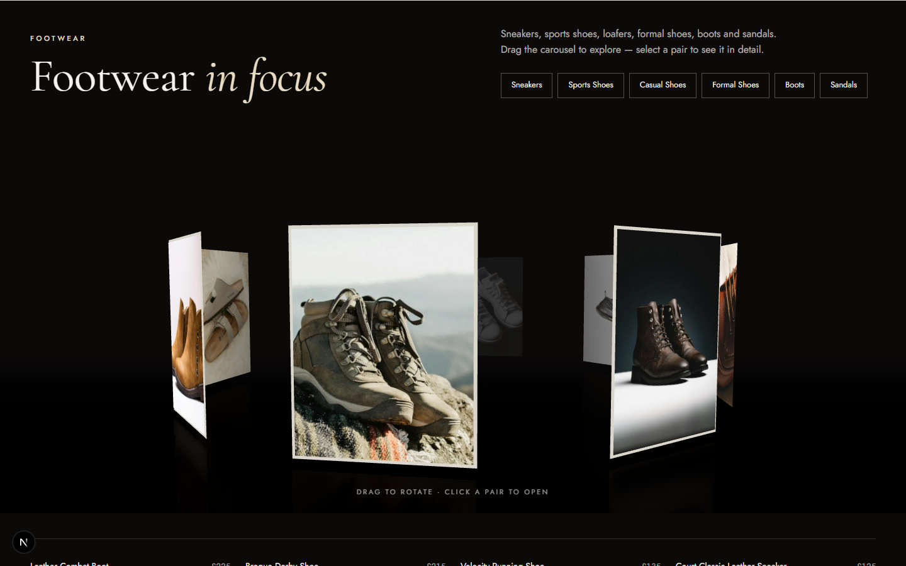
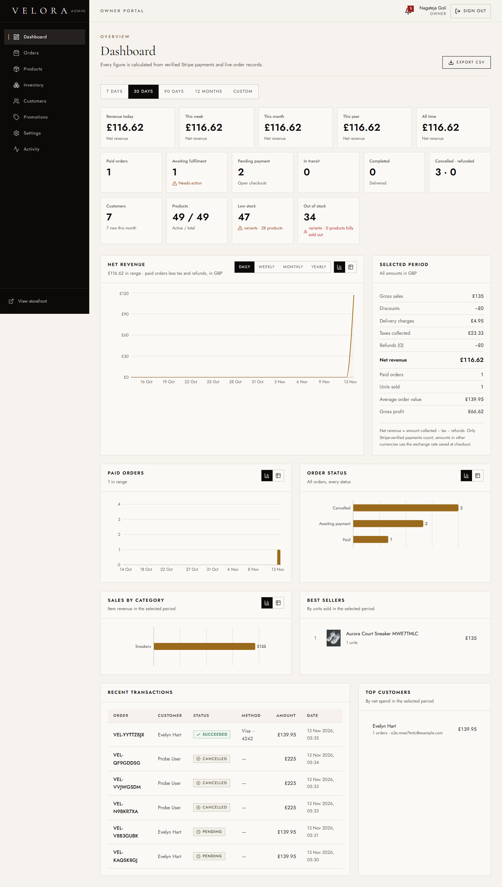
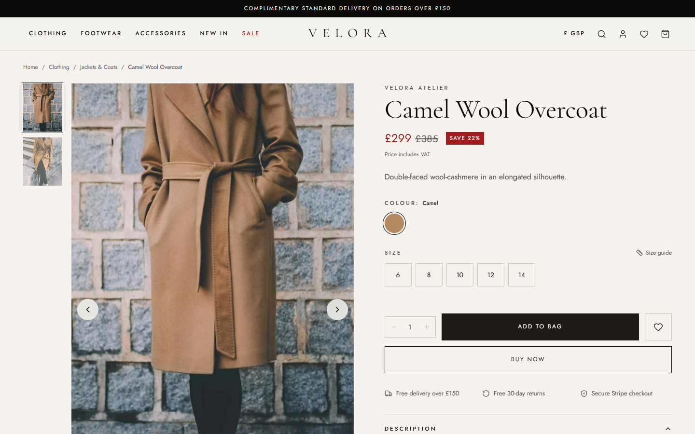
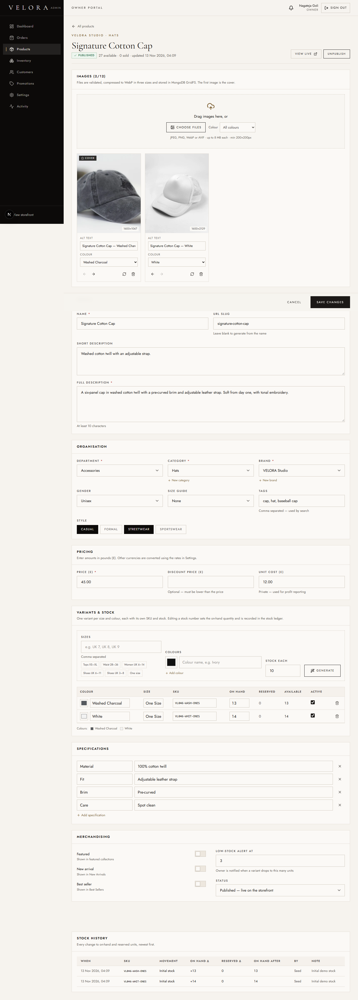

# VELORA — Premium Fashion Commerce Platform

A production-oriented e-commerce platform for a fashion house selling clothing, footwear and accessories. It has a cinematic, 3D-animated customer storefront, a separate owner portal, and one shared API backed by **MongoDB Atlas** with **product images stored as real files in MongoDB GridFS**. Payments run on **Stripe Checkout** with signed webhooks, and changes sync in real time over **Socket.IO**.


| Storefront | Owner portal |
| --- | --- |
|  |  |
|  |  |

---

## Contents

- [Features](#features)
- [Tech stack](#tech-stack)
- [Project structure](#project-structure)
- [Quick start](#quick-start)
- [URLs and accounts](#urls-and-accounts)
- [Testing](#testing)
- [How the critical flows work](#how-the-critical-flows-work)
- [Configuration reference](#configuration-reference)
- [Known limitations](#known-limitations)
- Guides: [MongoDB & GridFS](docs/DATABASE.md) · [Stripe](docs/STRIPE.md) · [API reference](docs/API.md) · [Revenue rules](docs/ANALYTICS.md) · [Deployment](docs/DEPLOYMENT.md) · [3D showroom](docs/SHOWROOM.md)

---

## Features

### Customer storefront
- **Real-time 3D hero.** Procedural WebGL silk (React Three Fiber, physical material with sheen) that responds to the cursor and to scrolling, with a static fallback for reduced motion or devices without WebGL.
- **3D footwear showcase.** Product photographs arranged on a draggable 3D ring over a reflective floor. These are photos in a 3D scene, not 3D shoe models. Phones get a swipe gallery instead.
- **Motion throughout.** GSAP ScrollTrigger reveals, parallax and a pinned horizontal "Edit" rail; Lenis smooth scrolling; Framer Motion page transitions; animated mega menu; 3D tilt product cards; a fly-to-bag animation; skeleton loaders; and a branded intro. Every effect respects `prefers-reduced-motion`.
- **Separate departments.** Clothing, footwear and accessories each have category, gender and style navigation (casual, formal, streetwear, sportswear).
- **Shop listings.** Filters for category, gender, style, size, colour, brand, price, rating, availability and sale, plus sorting options. Filter state lives in the URL so any view can be linked.
- **Search.** Debounced suggestions for products, categories and brands, with full-text search and partial-word matching.
- **Product pages.** Photo gallery with lens zoom, swipe and full-screen view. Customers can only choose size and colour combinations that are in stock, with live "only X left" messages. Also includes a size guide, specifications, delivery and returns, verified-purchase reviews, related products, Buy now and wishlist.
- **Bag, wishlist, checkout.** Guests can browse, keep a bag and fill in checkout without an account; pressing **Pay** asks them to create an account (or sign in) in a pop-up, keeps their bag and details, and continues straight to payment. **UK delivery only:** the country list is the United Kingdom, postcodes must be real UK postcodes (stored as "SW1A 1AA"; Channel Islands and Isle of Man excluded), and the API re-checks every address, including ones saved earlier, before taking an order. The rules live in `backend/src/utils/address.ts`. Coupons and automatic seasonal sales apply at checkout, along with delivery options, VAT, GBP/USD and saved addresses, with payment through Stripe Checkout (cards, Apple Pay, Google Pay).
- **Accounts.** One sign-in page for everyone (`/login`): owner/staff credentials open the owner portal, customer credentials open My Account. Registration, email verification, password reset, profile, saved addresses, order history and live order tracking.
- **3D showroom (`/showroom`).** Garments hang on black rails in a white gallery: pill tabs glide between rails, pieces slide in and sway, and selecting one zooms in with a product card and Add to bag (existing cart). Entry points are on category pages, product pages and the homepage. See [docs/SHOWROOM.md](docs/SHOWROOM.md), including the cut-out images to add.

### Owner portal (`/admin`)
- Separate admin accounts with an `owner`, `manager` or `staff` role, 12-hour sessions, account lockout and an audit log.
- **Dashboard.** Net revenue for today, this week, this month, this year and all time, drawn only from verified payments. Includes a breakdown of gross sales, discounts, delivery, tax, refunds and net revenue; profit once product costs are set; charts by day, week, month and year; sales by category; best sellers; order status; recent transactions; top customers; CSV export.
- **Products.** Full create, edit, archive and delete, a variant matrix with SKUs, and merchandising flags. The **GridFS image manager** handles multiple uploads, replacing, deleting, colour tags, alt text and reordering by drag or keyboard.
- **Inventory.** Stock per SKU/size/colour showing on-hand, reserved and available. You can set an absolute stock level, restock, or make an adjustment (with a required note); every change is recorded in a full stock ledger.
- **Orders.** Search and filters. Fulfilment moves through pending payment → paid → processing → packed → shipped → out for delivery → delivered, with tracking numbers, internal notes, cancellation, and full or partial Stripe refunds with optional restock.
- **Customers, promotions, settings.** Customer list and suspension; coupons and automatic sales; and store settings: name, logo, contact details, currencies and exchange rates, tax, delivery methods, announcement bar, homepage banners (stored in GridFS), return policy, social links and staff.

### Platform
- **Real-time sync.** Socket.IO pushes owner changes (products, prices, images, stock, banners) to every open storefront without a refresh. MongoDB stays the source of truth, and notifications are saved so nothing is lost while someone is offline.
- **Inventory that can't oversell.** Stock is reserved atomically at checkout inside transactions. It is deducted only after Stripe verifies payment, and reservations are released automatically when a checkout expires, fails or is cancelled.
- **Security.** Argon2id password hashing, httpOnly SameSite cookies, CSRF origin checks, Zod validation on every input, blocking of database-operator injection, rate limits, uploaded images validated by decoding them, Helmet headers and role-based permissions.
- **Notifications.** Emails for order confirmation, shipping, delivery, cancellation and refunds; alerts to the owner for new orders and low or out-of-stock items. Both email and in-app.

---

## Tech stack

| Layer | Technology |
| --- | --- |
| Storefront & admin | Next.js 16 (App Router) · React 19 · TypeScript · Tailwind CSS 4 · Framer Motion · GSAP + ScrollTrigger · Lenis · Three.js · React Three Fiber · Drei · TanStack Query · Zustand · Recharts · Lucide |
| API | Node.js 20+ · Express 5 · TypeScript · Zod · Mongoose 9 · Socket.IO · Stripe · Sharp · Multer · Argon2 · Nodemailer · BullMQ/Redis (optional) |
| Data | MongoDB Atlas (replica set → transactions) · GridFS (`fs.files` / `fs.chunks`) |
| Testing | Vitest + Supertest + mongodb-memory-server (replica set) · Playwright |

---

## Project structure

```
backend/                 Express API (TypeScript)
  src/
    config/env.ts        validated environment
    db/                  connection, transactions, GridFS bucket, indexes
    models/              Mongoose schemas (users, admins, products, orders, payments …)
    services/            inventory, cart & pricing, orders & Stripe, images, analytics, email …
    routes/              public, auth, shop, webhook, admin/*
    realtime/socket.ts   Socket.IO rooms (storefront / admin / user:<id>)
    jobs/queue.ts        BullMQ (Redis) or in-process scheduler
    seed/                catalogue definition + bundled photos → GridFS on first start
  tests/                 Vitest integration tests (in-memory MongoDB replica set)
frontend/                Next.js storefront + owner portal
  src/app/(store)/       customer pages
  src/app/admin/         owner portal
  src/components/        store, home, three (3D), admin, ui
  tests/e2e/             Playwright acceptance test
docs/                    guides and screenshots
scripts/dev.mjs          runs API + web together
```

---

## Quick start

**Prerequisites:** Node.js 20.10+ (tested on 24), npm 10+, a MongoDB Atlas cluster (or any MongoDB 6+ replica set), and Stripe test keys.

```bash
# 1. Install
npm run install:all

# 2. Configure
cp backend/.env.example backend/.env          # fill in MONGODB_URI, SESSION_SECRET, ADMIN_*, STRIPE_*
cp frontend/.env.example frontend/.env.local  # defaults work for local development

# 3. Run both apps (API :4000, storefront :3000)
npm run dev
```

**Windows, one click:** double-click `start-velora.bat`. It checks Node and `backend/.env`, closes any old VELORA servers, installs packages on first run, builds and starts the API and then the storefront (each in its own window), and opens http://localhost:3000. Sign in there with the owner email to reach the owner portal. `stop-velora.bat` stops everything.

On first start the API seeds the demo catalogue: 46 products, 80 product photos (each stored in three sizes), 8 banners, categories, brands, two coupons and the owner account from `ADMIN_EMAIL` / `ADMIN_PASSWORD`. This takes about 2–3 minutes against Atlas because every photo is processed and uploaded to GridFS. Later starts skip seeding.

Production:

```bash
npm run build
npm start
```

Reset the database to a clean demo catalogue: `npm run seed:reset`. **This deletes all data in the configured database.**

---

## URLs and accounts

| | URL |
| --- | --- |
| Storefront | http://localhost:3000 |
| Sign in (owners and customers) | http://localhost:3000/login |
| Owner portal | http://localhost:3000/admin |
| API health | http://localhost:4000/api/health |

The owner account is created on first start from `ADMIN_EMAIL` and `ADMIN_PASSWORD` in `backend/.env`. The password is stored only as an Argon2id hash. Use the **Settings → Team** tab to add managers and staff. Customers register on the storefront (or when they first press Pay).

The storefront **Sign in** page accepts both kinds of account: an owner/manager/staff email opens the owner portal (`/admin`), a customer email opens My Account (`/account`). `/admin/login` still works as a direct owner sign-in.

Demo coupon codes: `WELCOME10` (10% off over £50, once per customer) and `VELORA15` (15% off over £150).

Stripe test card: `4242 4242 4242 4242`, any future expiry date and any CVC.

---

## Testing

```bash
npm test            # backend: 55 integration tests against an in-memory MongoDB replica set
npm run test:e2e    # Playwright acceptance test against the running stack (needs Stripe test keys)
npm run typecheck   # backend + frontend
```

The backend suite covers:
- **Authentication:** register and login; sessions and cookie flags; password reset; email verification; CSRF; operator injection; admin lockout; role permissions; one sign-in form routing owners to the portal and customers to their account.
- **Catalogue:** filters, search, currency conversion, and hiding drafts.
- **GridFS:** upload, retrieval and caching; replace and delete with no orphaned files; content, type and size validation; files persisting across a database reconnect; first-start seeding of every image.
- **Inventory and payments:**
  - Reserving stock, then deducting only after a signed webhook (20 → 19).
  - Duplicate webhooks and invalid signatures.
  - The last unit selling out and restocking.
  - Six buyers competing for three units, with and without transactions.
  - Re-checking stock and prices at checkout.
  - Expired, failed and cancelled checkouts, and Stripe being unreachable.
- **Discounts, refunds and orders:** coupons, USD checkout, partial and full refunds with restock, and allowed status transitions.
- **Analytics:** revenue accounting checked against the raw records, and CSV export.
- **Real-time:** product, price and stock events, and isolation between customer and admin rooms.
- **Rate limiting.**

The Playwright test runs the complete acceptance workflow:
- The owner creates a product, uploads images to GridFS and sets stock to 25.
- The product appears live on the storefront.
- The customer pays on Stripe's real test checkout.
- Stock drops from 25 to 24, and the dashboard and order history update.
- A price edit, an image replacement, a sell-out and a restock all reach the open product page live.
- The order is refunded through Stripe.

---

## How the critical flows work

**Images (GridFS).**
- Uploads are decoded with Sharp, so a renamed file can't get through.
- Metadata is stripped, orientation is fixed, and three WebP sizes (480, 960 and 1800 px) are stored in GridFS.
- Products store only GridFS ObjectIds. `GET /api/images/:fileId` streams the file with an ETag and year-long immutable caching; replacing an image creates a new id.
- Replacing or deleting an image removes the old files, except small thumbnails still used in past orders.
- A scheduled job removes any orphaned files left by interrupted uploads.

**Checkout and stock.**
1. When the customer goes to payment, every price, discount, delivery charge and tax amount is recalculated on the server from MongoDB.
2. In one transaction, each line's stock is reserved with a single conditional update (`available ≥ qty`) and the order is created as `pending_payment`.
3. A Stripe Checkout Session is created with an idempotency key and an expiry.
4. A signed `checkout.session.completed` webhook marks the order paid. Stock is deducted and the reservation cleared in the same transaction. Each webhook event is processed only once.
5. If the checkout expires, fails or is cancelled, the reserved stock is returned. A scheduled job double-checks with Stripe before releasing anything.
6. The success page also asks the server to fetch the session from Stripe's API, which covers delayed webhooks. A payment is never accepted on the browser's word alone.

See [docs/STRIPE.md](docs/STRIPE.md) and [docs/ANALYTICS.md](docs/ANALYTICS.md).

---

## Configuration reference

See [`backend/.env.example`](backend/.env.example) and [`frontend/.env.example`](frontend/.env.example). The key settings:

| Variable | Purpose |
| --- | --- |
| `MONGODB_URI` | Atlas connection string; the database name is in the path (e.g. `/velora`) |
| `SESSION_SECRET` | 32+ random characters, used to sign session and reset tokens |
| `ADMIN_EMAIL`, `ADMIN_PASSWORD` | Owner account created on first start |
| `STRIPE_SECRET_KEY`, `STRIPE_WEBHOOK_SECRET` | Stripe API key and webhook signing secret |
| `REDIS_URL` | Optional; enables BullMQ background jobs |
| `SMTP_*`, `EMAIL_TRANSPORT` | Email delivery (`log` prints emails instead of sending them) |
| `CLIENT_URL`, `CORS_ORIGINS`, `COOKIE_*` | Storefront origin and cookie policy |
| `NEXT_PUBLIC_API_URL`, `API_INTERNAL_URL` | Where the browser and the Next.js server reach the API |

---

## Known limitations

- **3D product models.** The catalogue has photographs only, so the 3D scenes use procedural silk and photos placed in 3D space; nothing is shown as a fake 3D model. The gallery and showcase can host real `.glb` models when they're available.
- **Demo photography.** Demo product photos come from Unsplash (Unsplash License; see [`backend/src/seed/assets/manifest.json`](backend/src/seed/assets/manifest.json)). Some show third-party brand marks (e.g. a sneaker stripe). Replace them with the client's own product photography before going live.
- **Exchange rates.** USD prices are converted from GBP using a rate set by the owner (Settings → Currencies), not live market rates.
- **Tax.** A single store-wide rate (inclusive or exclusive). Per-region tax would need Stripe Tax or a tax service.
- **Background jobs.** Without `REDIS_URL`, jobs run in-process, which is fine for one API instance. With several instances, set `REDIS_URL` so BullMQ coordinates them.
- **Guest checkout.** Guests can keep a bag, but checkout requires an account so orders can be tracked.
